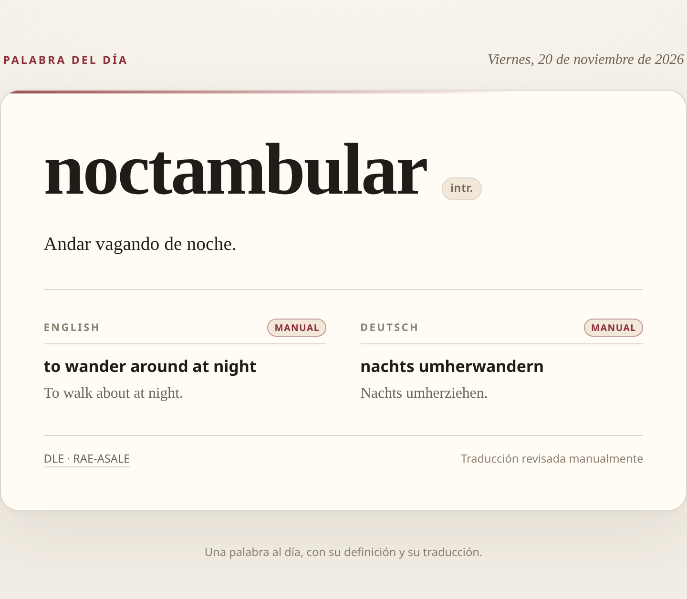

# Palabra del día

A small daily card with the RAE word of the day, its definition, and its
English and German translations.



One static page, one scheduled job, no server and no database. The RAE is
fetched once a day, DeepL translates the entry, and GitHub Pages serves the
result. The last successful card stays online if a daily run fails.

---

## How it works

```
GitHub Actions (daily cron)
  -> fetch dle.rae.es
  -> extract the word, date, part of speech and definitions
  -> translate the primary sense with DeepL (EN + DE)
  -> apply manual overrides
  -> write data/latest.json and data/archive/YYYY-MM-DD.json
  -> build dist/ and deploy GitHub Pages

Browser / PWA
  -> reads data/latest.json
  -> shows the card, or the last card with a stale notice
```

The DeepL key lives in GitHub Actions secrets. The browser never sees it.

---

## Stack

- Static HTML, CSS and JavaScript. No framework.
- Python 3.11+ for the daily fetch, with `requests` and `beautifulsoup4`.
- DeepL API Free for translation.
- GitHub Actions for the schedule and GitHub Pages for hosting.
- A service worker and web manifest make the page installable as a PWA.

---

## Repository layout

```
site/                 Static page, styles, script, manifest, service worker, icons
scripts/daily.py      Fetch, translate and write the daily JSON
scripts/build.py      Assemble dist/ with the latest data and overrides
scripts/lib/          RAE parser and DeepL client
tests/                Parser fixtures and unit tests
data/latest.json      Entry shown by the site
data/archive/         One JSON file per day
overrides/terms.json  Manual translation corrections
.github/workflows/    Daily job and Pages deployment
```

---

## Setup

### 1. DeepL

Create a DeepL API Free account at <https://www.deepl.com/pro-api> and copy
the authentication key. The free tier is far more than this project needs:
four short requests per day.

### 2. GitHub

Create a public repository named `palabra-del-dia`, push this project, then:

1. Go to **Settings > Secrets and variables > Actions** and add
   `DEEPL_API_KEY`.
2. Go to **Settings > Pages > Build and deployment** and set **Source** to
   **GitHub Actions**.
3. Open **Actions > Palabra del día > Run workflow**.

The site will be at `https://<your-user>.github.io/palabra-del-dia/`.

The repository must be public for GitHub Pages on the free plan. No secret is
stored in the repository.

### 3. Local preview

```bash
python3 -m venv .venv
source .venv/bin/activate
pip install -r requirements.txt

export DEEPL_API_KEY="your-key"
python scripts/daily.py
python scripts/build.py
python -m http.server 8765 -d dist
```

Open <http://localhost:8765/>.

To fetch the RAE entry without calling DeepL:

```bash
python scripts/daily.py --skip-translation
```

You can also put the key in a local `.env` file:

```
DEEPL_API_KEY=your-key
```

`.env` is ignored by Git.

---

## Tests

```bash
python -m unittest discover -s tests -v
```

The parser tests use saved copies of the DLE homepage and two entry pages in
`tests/fixtures/`, so they do not touch the network.

---

## Data format

`data/latest.json` contains:

| Field | Meaning |
|---|---|
| `date` | ISO date of the DLE edition |
| `display_date` | Date as shown by the DLE |
| `word` | Headword |
| `pos` | Part of speech, for example `["intr."]` |
| `url` | Link to the DLE entry |
| `definition` | Primary RAE definition |
| `other_senses` | Up to four additional RAE senses, Spanish only |
| `translations.en` / `.de` | Translated term and definition |
| `translation_status` | `ok`, `manual`, `failed` or `skipped` |
| `source` | Attribution |

Only the primary sense is translated. The other senses are shown in Spanish
and linked to the full entry, because translating every sense of a polysemous
word would make the card much longer and the translation less reliable.

---

## Translation overrides

DeepL is machine translation. For a word where the automatic result is not
the exact term you want, add an override:

```json
{
  "word": {
    "en": {
      "term": "the exact English equivalent",
      "definition": "A translation of the RAE definition."
    },
    "de": {
      "term": "das genaue deutsche Äquivalent",
      "definition": "Eine Übersetzung der RAE-Definition."
    }
  }
}
```

`overrides/terms.json` is applied both when the daily data is written and when
the site is built. An override takes precedence over DeepL and is displayed
with a **Manual** badge. The included `noctambular` entry is an example.

Because the build step applies overrides, editing that file and pushing is
enough to update the site without waiting for the next daily run.

---

## Why "exact" translations need a human check

A Spanish word can have several senses, and each sense can have a different
translation. The pipeline translates the primary RAE definition with DeepL and
sends that definition as `context` when translating the headword. This
disambiguates the sense, but DeepL is still machine translation.

The card shows the translated term and the translated definition together, so
the result can be checked. For a word where the automatic result is wrong or
too approximate, use an override. The UI labels automatic translations as
**DeepL** and manual corrections as **Manual**.

---

## Schedule

The workflow runs at `05:30 UTC` every day:

```yaml
schedule:
  - cron: "30 5 * * *"
```

That is 06:30 in Madrid in winter and 07:30 in summer. The DLE updates the
word at midnight Madrid time. GitHub cron can be delayed by a few minutes;
the page simply keeps showing the previous card until the job finishes.

To change the time, edit `.github/workflows/daily.yml`.

---

## Maintenance

- **RAE markup changes**: update `scripts/lib/rae.py` and refresh the fixtures
  in `tests/fixtures/`. The tests will show what broke.
- **Cloudflare challenge**: a request with normal browser headers currently
  returns the DLE page. If GitHub runner IPs start receiving challenges, the
  fallback is to render the page with Playwright in the workflow, or to run the
  daily job from a different machine.
- **Icons**: `python scripts/make_icons.py` regenerates them. This needs
  Pillow, which is not required at runtime.
- **DeepL key rotation**: replace the `DEEPL_API_KEY` secret. Nothing else
  changes.

---

## Attribution and scope

- Definitions come from the *Diccionario de la lengua española*, 24.ª edición
  (RAE-ASALE). Each card links to the source entry.
- Translations are produced by DeepL or entered manually in the overrides
  file.
- This is a personal, low-volume project: one entry per day, cached, with
  attribution. It does not redistribute the dictionary.
